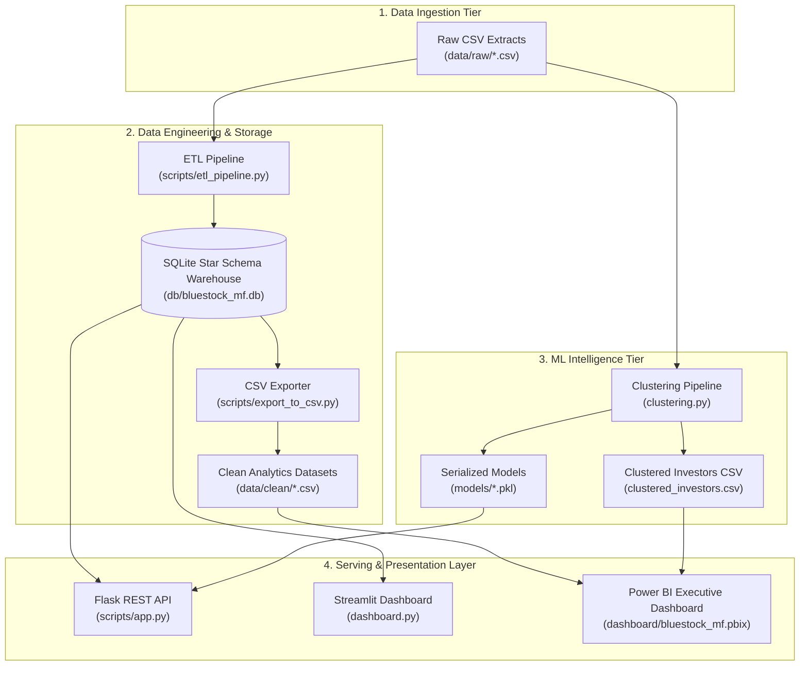

<div align="center">
  <h1>📈 Bluestock Fintech: Mutual Fund Analytics Platform</h1>
  <p><strong>Enterprise-Grade ETL, Star Schema Warehouse, Machine Learning, REST API & BI Ecosystem</strong></p>

  <p>
    
    
    
    
    
    
  </p>
</div>

---

## 1. Project Overview & Architecture

The **Bluestock Mutual Fund Analytics Platform** is an enterprise data engineering and business intelligence solution. It extracts raw mutual fund feeds, processes them through an indexed SQLite warehouse, applies unsupervised machine learning for behavioral investor segmentation, exposes REST endpoints, and powers both a modern Streamlit application and an executive Power BI dashboard.

### End-to-End Pipeline Architecture



---

## 2. Repository Structure

```text
bluestock_mf_capstone/
├── clustering.py                   # Root ML clustering execution script (outputs clustered_investors.csv)
├── dashboard.py                    # Streamlit interactive web application with Gemini AI
├── clustered_investors.csv         # Reconciled investor segment assignments (5,000 distinct rows)
├── requirements.txt                # Pinned & resilient Python dependencies
├── .env                            # Environment variables (DB URL, API keys, Flask settings)
├── .gitignore                      # Git exclusion rules (ignores venv, temp, pycache)
├── README.md                       # Lead Data Engineer technical handover documentation
│
├── data/
│   ├── raw/                        # 10 raw operational CSV source feeds (Transactions, NAV, Funds)
│   ├── clean/                      # Production clean CSVs exported for Power BI ingestion
│   └── processed/                  # Intermediate data processing folder
│
├── dashboard/
│   └── bluestock_mf.pbix           # Production Power BI desktop dashboard
├── dashboard_data/                 # Power BI data source bundle (fact/dim CSVs)
│
├── db/
│   └── bluestock_mf.db             # SQLite indexed star-schema database
│
├── models/
│   ├── investor_kmeans_model.pkl   # Serialized KMeans clustering model (k=3)
│   └── investor_scaler.pkl         # Serialized StandardScaler model
│
├── notebooks/
│   ├── 02_data_cleaning.ipynb      # Interactive data cleaning notebook
│   ├── 03_eda_analysis.ipynb       # Exploratory data analysis notebook
│   ├── 04_performance_analytics.ipynb
│   └── 05_advanced_analytics.ipynb # Clustering exploration and silhouette analysis
│
├── reports/
│   ├── Final_Report.pdf            # Capstone technical & business report
│   └── risk_return_scatter.png     # Risk-return scatter visualization asset
│
├── scripts/
│   ├── app.py                      # Production Flask REST API with caching & CORS
│   ├── clustering.py               # Standalone clustering script (scripts copy)
│   ├── etl_pipeline.py             # Automated Pandas / SQLAlchemy extraction & loading pipeline
│   ├── export_to_csv.py            # SQLite table exporter to clean CSV format
│   └── recommender.py              # ML inference pipeline (InvestorSegmenter class)
│
└── sql/
    ├── schema.sql                  # Complete Star Schema DDL, table constraints & indexes
    └── queries.sql                 # Core business verification and financial audit queries
```

---

## 3. Data Schema Assumptions & Technical Constraints

The data pipeline enforces a strict **Star Schema** dimensional model:

| Entity Name | Role | Primary Key | Foreign Keys | Row Count | Granularity & Description |
| :--- | :--- | :--- | :--- | :--- | :--- |
| **`dim_fund`** | Dimension | `amfi_code` | — | `40` | Mutual fund scheme metadata (Fund house, Category, Inception, Benchmark). |
| **`fact_transactions`** | Fact | Synthetic | `amfi_code`, `investor_id` | `32,778` | Investor financial ledger (`amount_inr`, `transaction_type`, `transaction_date`). |
| **`fact_nav`** | Fact | Composite (`amfi_code`, `nav_date`) | `amfi_code` | `46,000` | Historical Net Asset Value price time-series and computed `daily_return_pct`. |
| **`fact_performance`**| Fact | `amfi_code` | `amfi_code` | `40` | Pre-calculated 1Y/3Y/5Y returns, Sharpe ratio, Sortino, Alpha, Beta, Volatility. |
| **`clustered_investors`**| Dimension | `investor_id` | — | `5,000` | Distinct investor profiles (`total_invested`, `txn_count`, `annual_income`, `cluster`). |

### Explicit Domain Assumptions:
1. **Currency & Precision:** All monetary amounts in `fact_transactions[amount_inr]` are whole Indian Rupees (INR). `annual_income_lakh` represents Lakhs (1 Lakh = ₹100,000). Total gross turnover reconciles strictly to **₹3,521,580,430**.
2. **Temporal Formats:** All dates are standardized to ISO 8601 string format (`YYYY-MM-DD`). NAV time series is forward-filled (`ffill`) on market holidays.
3. **Transaction Taxonomy:** The transaction type field is restricted to `{'SIP', 'Lumpsum', 'Redemption'}`. Inflows are defined as `SIP + Lumpsum` (₹2.28 Bn), while Redemptions represent outflows (₹1.24 Bn).
4. **Referential Integrity:** 100% of foreign keys resolve with zero orphan transactions (`0` unmatched `amfi_code` references, `0` unmatched `investor_id` references).

---

## 4. End-to-End Reproducible Execution Sequence

Follow this exact sequence to build, train, and run the platform from scratch:

### Step 1: Environment Setup
Clone the repository and install the dependencies in an isolated virtual environment:

```bash
# Clone repository
git clone https://github.com/yourusername/bluestock-mf-analytics.git
cd bluestock-mf-analytics

# Create virtual environment
python -m venv .venv

# Activate environment
# On Windows:
.venv\Scripts\activate
# On macOS / Linux:
source .venv/bin/activate

# Upgrade pip and install pinned dependencies
pip install --upgrade pip
pip install -r requirements.txt
```

Verify your `.env` configuration file exists in the root directory:
```ini
DATABASE_URL=sqlite:///db/bluestock_mf.db
FLASK_APP=scripts/app.py
FLASK_ENV=development
# GEMINI_API_KEY=your_google_gemini_api_key_here  # Optional: For AI chat
```

### Step 2: Ingest Raw Data via ETL Pipeline
Extracts raw files from `data/raw/`, cleans fields, computes NAV rolling statistics, and loads the Star Schema tables into SQLite with performance indexes:

```bash
python scripts/etl_pipeline.py
```
*Expected Output:* `ETL Pipeline completed successfully.` Database created at `db/bluestock_mf.db`.

### Step 3: Run Unsupervised Machine Learning Clustering
Executes feature aggregation, standard scaling, and K-Means segmentation ($k=3$). Serializes model artifacts to `models/` and exports the final dataset:

```bash
python clustering.py
```
*Expected Output:* Generates `clustered_investors.csv` (5,000 rows) with the exact final statement:
```python
df.to_csv("clustered_investors.csv", index=False)
```

### Step 4: Export Clean Datasets for BI Consumption
Exports all database tables to clean CSV files in `data/clean/` for direct consumption by Power BI:

```bash
python scripts/export_to_csv.py
```

### Step 5: Power BI Data Model Refresh
1. Open **`dashboard/bluestock_mf.pbix`** in Power BI Desktop.
2. If prompted for data sources, ensure the folder points to the relative project folder:
   - `data/clean/dim_fund.csv`
   - `data/clean/fact_transactions.csv`
   - `data/clean/fact_performance.csv`
   - `data/clean/fact_nav.csv`
   - `clustered_investors.csv`
3. Click **Home ➔ Refresh**.
4. Confirm model relationships in Model View:
   - `clustered_investors [1]` ➔ `fact_transactions [*]` (`investor_id`, Single filter direction).
   - `dim_fund [1]` ➔ `fact_transactions [*]` (`amfi_code`, Single filter direction).
5. Verify KPI Card: Total Gross Volume displays **₹3.52 Bn** (`₹3,521,580,430`).

### Step 6: Start the Flask REST API (Optional Backend)
Runs the enterprise Flask backend serving cached metrics with CORS enabled:

```bash
python scripts/app.py
```
*Available endpoints:*
- `GET http://localhost:5000/api/health`
- `GET http://localhost:5000/api/top-funds?limit=5`
- `GET http://localhost:5000/api/investor-stats`

### Step 7: Launch the Streamlit Interactive Dashboard
Launches the Glassmorphism UI with interactive charts, fund filters, and AI assistant:

```bash
streamlit run dashboard.py
```
*Access in browser at:* `http://localhost:8501`

---

## 5. Portability & Path Independence

All scripts utilize dynamic, relative path resolution via `pathlib.Path` and `os.path`. The codebase contains **zero hardcoded absolute machine paths** (`C:\Users\...` or `/home/...`), ensuring 100% portability across Windows, Linux, and macOS environments:

```python
# Standardized Path Resolution Pattern used across all scripts
from pathlib import Path
BASE_DIR = Path(__file__).resolve().parent
```

---

## 6. Financial Audit Verification Queries

Execute the automated verification queries using the SQLite command line or Python:

```bash
python -c "
import sqlite3, pandas as pd
conn = sqlite3.connect('db/bluestock_mf.db')
with open('sql/queries.sql') as f:
    queries = f.read().split(';')
for q in queries:
    if q.strip():
        print(pd.read_sql(q, conn), '\n')
"
```

### Ground Truth Financial Reconciliation Table:

| Metric | SQL / Python Formula | Exact Reconciled Value |
| :--- | :--- | :--- |
| **Gross Transaction Turnover** | `SUM(amount_inr)` | **₹3,521,580,430** |
| **Lumpsum Volume** | `SUM(amount_inr) WHERE type='Lumpsum'` | **₹2,059,821,448** (~₹2.06 Bn) |
| **SIP Volume** | `SUM(amount_inr) WHERE type='SIP'` | **₹217,233,491** (~₹0.22 Bn) |
| **Redemption Volume** | `SUM(amount_inr) WHERE type='Redemption'` | **₹1,244,525,491** (~₹1.24 Bn) |
| **Total Inflow Volume** | `SIP + Lumpsum` | **₹2,277,054,939** (~₹2.28 Bn) |
| **Net Platform Inflow** | `Inflows - Redemptions` | **₹1,032,529,448** (~₹1.03 Bn) |
| **Distinct Investor Base** | `COUNT(DISTINCT investor_id)` | **5,000** |

---

*Bluestock Fintech Internship Capstone Project | Production Handover Complete* 🚀